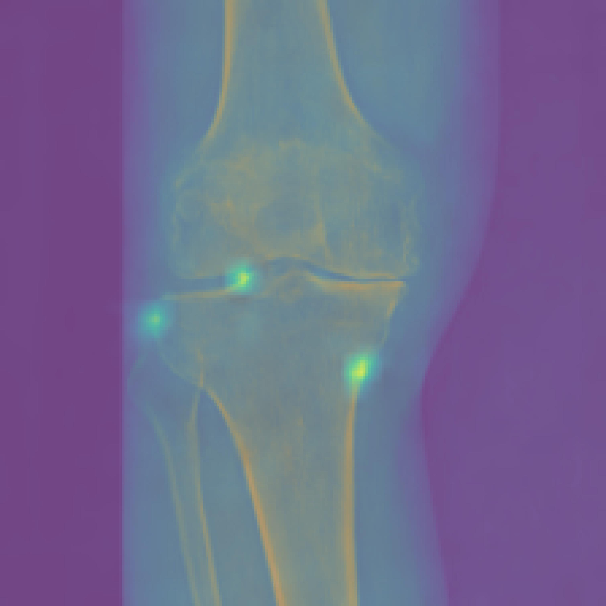
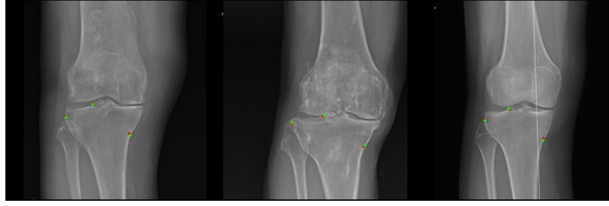
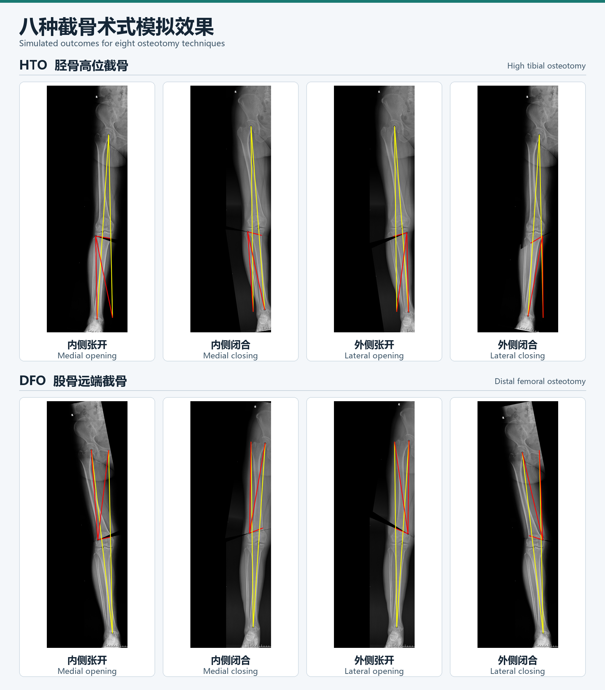

# PFDNet Implementation for HTO and DFO Preoperative Planning from Lower Limb X-rays

[简体中文](README.md) · **English**

This project contains lower limb image annotation, PFDNet training and prediction, landmark geometry, and osteotomy image simulation. The release includes source code, dependencies, documentation, and figures. Supply your own training images, annotations, checkpoints, and results.

| Stage | Module | Purpose |
| --- | --- | --- |
| 1 | [keypoint/annotation](keypoint/annotation) | Mark landmarks and export or update LabelMe annotations |
| 2 | [keypoint/data](keypoint/data), [keypoint/models](keypoint/models) | Read MAT or JPG pairs, build Gaussian targets, and define PFDNet and Res2Net |
| 3 | [train.py](keypoint/train.py), [predict.py](keypoint/predict.py) | Train, validate, and predict from single or multiple images, with overlays and heatmap export |
| 4 | [keypoint/planning](keypoint/planning) | Measure mLDFA, JLCA, MPTA, and LDTA, compute Fujisawa and Miniaci angles, simulate HTO and DFO on one cropped leg, and detect ruler segments |

## 1. Install and annotate

Python 3.10 or 3.11 is recommended. Select PyTorch and torchvision builds that match your system and CUDA environment. Run these commands from the repository root.

```powershell
python -m venv .venv
.venv\Scripts\python -m pip install -r requirements.txt
.venv\Scripts\python -m keypoint.annotation.gui ../local-data/images
```

On Linux and macOS, the virtual environment uses `.venv/bin/python`. Interactive annotation needs a desktop session. If you omit the image directory, the folder picker also needs Python’s Tkinter module. Use the virtual environment’s Python for the remaining commands. Left click adds a point, right click undoes the last point, Up and Down select a label, Left and Right change images, and Esc saves and exits. Annotations are saved alongside each image as text rows in the form `('label', (x, y))`. An optional `label.labels` file defines label names and colors as `('label', (B, G, R))`.

```powershell
python -m keypoint.annotation.labelme --image ../local-data/images/demo.png --points ../local-data/points.txt --output ../local-data/labelme/demo.json
```

The converter expects three rows in this order: hinge, other cut endpoint, and Fujisawa target. To update the target in an existing LabelMe file, pass `--existing` and supply one text row. The saved JSON references the image through `imagePath`.

## 2. Prepare the training data

MAT files are grouped by region. For a knee sample, `kneesample/kneesample1.mat` contains the `kneesample` image variable, and `kneelabels/kneelabel1.mat` contains the `kneelabel` variable. The corresponding prefixes for hip and ankle are `hip` and `ankle`. Samples and labels are matched by shared ID. Append `_val` to the validation directory names and optionally `_test` to test directories. Keep the file names and variable names in the same format.

Images are BGR or grayscale arrays. Labels store source image pixel coordinates in `x1, y1, x2, y2, …` order. Hip, knee, and ankle have one, six, and three landmarks respectively. Training resizes images to 224 × 224 and creates a Gaussian target for each point. Keep crops, point ordering, and laterality consistent across the inputs.

### JPG / JPEG data

The loader pairs files by name, for example `sample01.jpg` with `sample01.txt`. Write one `('label', (x, y))` per line in source image pixels. Keep the same landmark count and row order across files. JPG images can also use the regional directories and MAT label naming above.

Pass the original annotation project's `train_images`, `val_images`, and TXT label directories directly. In this example, `labels` is the three-point annotation directory. `--point-count 3` configures the model for those landmarks.

```powershell
python -m keypoint.train --region knee --point-count 3 --images-dir ../local-data/train_images --labels-dir ../local-data/labels --val-images-dir ../local-data/val_images --val-labels-dir ../local-data/labels --output weights/knee_jpg.pth
python -m keypoint.predict --region knee --point-count 3 --input ../local-data/val_images --labels-dir ../local-data/labels --weights weights/knee_jpg.pth --output results/knee_jpg.json
```


## 3. Train and predict


*PFDNet architecture. The outputs of the two aggregation branches are added to form landmark heatmaps.*

```powershell
python -m keypoint.train --region knee --data-root ../local-data/Mat_Dataset --output weights/knee.pth --validate
python -m keypoint.predict --region knee --input ../local-data/Mat_Dataset/kneesample_test --weights weights/knee.pth --output results/knee.json --labels-dir ../local-data/Mat_Dataset/kneelabels_test --overlay-dir results/overlays --heatmap-dir results/heatmaps
```

You can also set `--region` to `hip` or `ankle`. Set `--validate` for validation, `--backbone-weights` for a local Res2Net checkpoint, and `--device` to select the compute device. Prediction also accepts ordinary image files. Output points are `(x, y)` in the source image. Supplying `--labels-dir` adds pointwise Euclidean distances in pixels. Inference uses the first channel of legacy hip checkpoints that have three outputs.



*Example knee heatmap. Bright spots mark locations with a stronger model response.*



*Landmark prediction overlays on knee radiographs.*

## 4. Measure and simulate



*Simulated outcomes for eight osteotomy techniques. The top row shows high tibial osteotomy (HTO), and the bottom row shows distal femoral osteotomy (DFO).*

```powershell
python -m keypoint.planning measure --points ../local-data/measure.json
python -m keypoint.planning fujisawa --points ../local-data/target.json
python -m keypoint.planning miniaci --points ../local-data/target.json --method HTO --mode MOpen --image ../local-data/images/demo.png --output results/preview.png
python -m keypoint.planning ruler --image ../local-data/images/demo.png --roi 4 20 80 12 --span 10
```

`measure` expects a single `hip` point and three arrays `knee_upper`, `knee_lower`, and `ankle`, each containing the center followed by two endpoints. Run it separately with original and corrected landmark sets to compare the angles.

`fujisawa` reads three points named `hip`, `target`, and `ankle`. `miniaci` also needs a `hinge` point and uses `cut_end` when rendering a preview. Use coordinates in pixels from the top left of the supplied single-leg crop. `MOpen`, `MClose`, `LOpen`, and `LClose` denote medial opening, medial closing, lateral opening, and lateral closing. The ruler ROI is `x y width height`, and `--span` supplies the known length of a candidate segment. The measurements and simulations are research outputs and have not been clinically validated.

Use these synthetic coordinates as a template for `target.json`. Each joint line in the measurement file has the form `[[cx, cy], [x1, y1], [x2, y2]]`.

```json
{"hip": [22, 8], "ankle": [25, 52], "target": [24, 30], "hinge": [14, 28], "cut_end": [41, 33]}
```

## Citation and copyright

Wu Z, Zhang R, Bai H, Ma J, Ma X, Zhu X. [Keypoint estimation of knee x-ray images using a parallel fusion decoding network](https://www.sciencedirect.com/science/article/abs/pii/S0968016022002101). *The Knee*.

Please cite the paper above when using the model, code, or research results. When citing or reusing the code, credit PFDNet, link to this repository, and retain existing copyright and attribution notices.

**Paper copyright** belongs to the rights holder identified in the published article. Follow the article’s license when reproducing its text, figures, or other material.

**Code copyright** belongs to the respective rights holders. Use, modification, and distribution are subject to the applicable license or permission.
