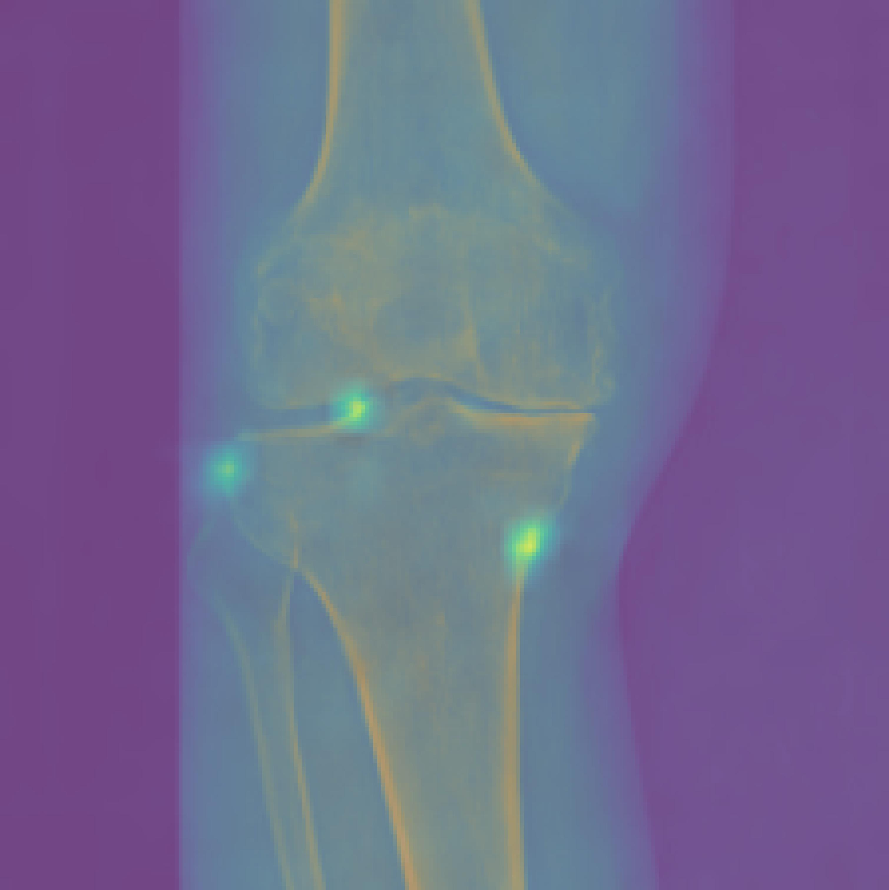
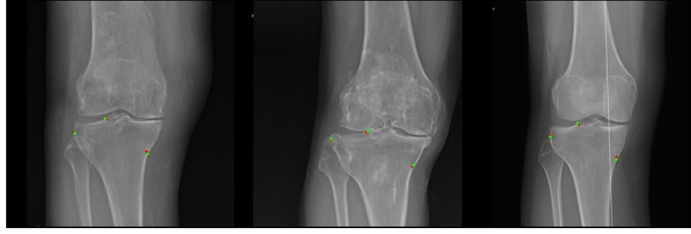
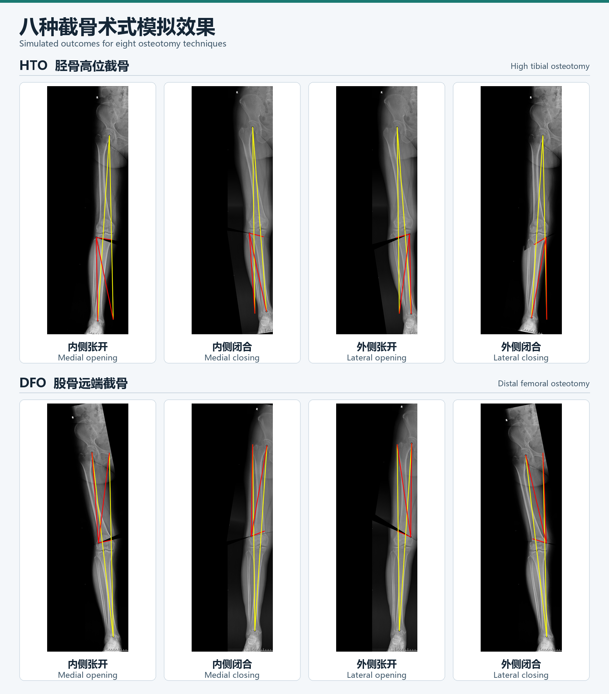

# 基于PFDNet的人体下肢xray的HTO DFO术前规划算法实现方案

**简体中文** · [English](README.en.md)

项目包含下肢影像关键点标注、PFDNet 训练与推理，以及基于关键点的角度测量和截骨图像模拟。发布目录包含源码、依赖清单、文档和展示图。训练影像、标注、权重和运行结果由使用者在本地提供。

| 顺序 | 模块 | 用途 |
| --- | --- | --- |
| 1 | [keypoint/annotation](keypoint/annotation) | 打点标注、导出或更新 LabelMe JSON |
| 2 | [keypoint/data](keypoint/data)、[keypoint/models](keypoint/models) | 读取 MAT 或 JPG 样本及标签，生成高斯热力图，提供 PFDNet 与 Res2Net |
| 3 | [train.py](keypoint/train.py)、[predict.py](keypoint/predict.py) | 训练、验证、单图与批量推理，输出点坐标、叠加图及热力图 |
| 4 | [keypoint/planning](keypoint/planning) | mLDFA、JLCA、MPTA、LDTA 测量，Fujisawa 与 Miniaci 计算，HTO/DFO 单腿图像模拟及标尺线检测 |

## 1. 安装与标注

推荐 Python 3.10 或 3.11。根据系统及 CUDA 环境选择对应的 PyTorch 与 torchvision。以下命令从仓库根目录运行。

```powershell
python -m venv .venv
.venv\Scripts\python -m pip install -r requirements.txt
.venv\Scripts\python -m keypoint.annotation.gui ../local-data/images
```

在 Linux 和 macOS 上，虚拟环境中的 Python 路径为 `.venv/bin/python`。交互标注需要桌面环境，省略图像目录时还需要 Python 的 Tkinter 文件选择器。后续命令中的 `python` 指虚拟环境里的 Python。标注窗口中，左键添加点，右键撤销最近一个点，上下键切换标签，左右键切换图像，Esc 保存退出。每行文本格式为 `('label', (x, y))`，文件保存在图像旁。可选的 `label.labels` 每行使用 `('label', (B, G, R))` 定义标签与颜色。

```powershell
python -m keypoint.annotation.labelme --image ../local-data/images/demo.png --points ../local-data/points.txt --output ../local-data/labelme/demo.json
```

转换时按旋转中心、截骨线另一端、Fujisawa 点填写三行。使用 `--existing` 传入已有 LabelMe JSON 并提供一行文本可更新 Fujisawa 点。生成的 JSON 通过 `imagePath` 引用图像。

## 2. 准备训练数据

MAT 目录按部位组织。以膝为例，影像 `kneesample/kneesample1.mat` 内的键为 `kneesample`，标签 `kneelabels/kneelabel1.mat` 内的键为 `kneelabel`。髋和踝分别使用 `hip` 和 `ankle` 前缀。训练自动按共同编号配对。验证目录加 `_val` 后缀，测试目录可加 `_test` 后缀，文件名和内部键保持一致。

影像为 BGR 三通道矩阵或灰度矩阵，标签为按 `x1, y1, x2, y2, …` 排列的原图像素坐标。髋、膝、踝分别保留 1、6、3 个点。训练读入时将影像缩放到 224 × 224，并为每个点生成高斯热力图。影像裁剪、标签顺序、左右腿对应关系由输入数据保持一致。

### JPG / JPEG 数据

加载器按文件名配对，例如 `sample01.jpg` 对应 `sample01.txt`。标签每行写一个 `('label', (x, y))`，使用原图像素坐标。各文件中的点数和行顺序须一致。JPG 也可以沿用上一节的区域目录及 MAT 标签命名。

原标注项目的 `train_images`、`val_images` 和 TXT 标签目录可以直接传入。下例的 `labels` 指向三点标签目录。`--point-count 3` 让模型学习这套数据的三个点。

```powershell
python -m keypoint.train --region knee --point-count 3 --images-dir ../local-data/train_images --labels-dir ../local-data/labels --val-images-dir ../local-data/val_images --val-labels-dir ../local-data/labels --output weights/knee_jpg.pth
python -m keypoint.predict --region knee --point-count 3 --input ../local-data/val_images --labels-dir ../local-data/labels --weights weights/knee_jpg.pth --output results/knee_jpg.json
```


## 3. 训练与推理


*PFDNet 网络结构。两路特征聚合的输出相加，得到关键点热力图。*

```powershell
python -m keypoint.train --region knee --data-root ../local-data/Mat_Dataset --output weights/knee.pth --validate
python -m keypoint.predict --region knee --input ../local-data/Mat_Dataset/kneesample_test --weights weights/knee.pth --output results/knee.json --labels-dir ../local-data/Mat_Dataset/kneelabels_test --overlay-dir results/overlays --heatmap-dir results/heatmaps
```

`--region` 可改为 `hip` 或 `ankle`。验证集、已有的 Res2Net 权重和计算设备分别通过 `--validate`、`--backbone-weights`、`--device` 指定。推理也可直接读取普通图片。JSON 输出以原图像素表示 `(x, y)`，提供 `--labels-dir` 时，匹配的 MAT 标签用于计算各点的欧氏距离误差。旧髋部模型若输出三通道，推理使用第一个通道。



*膝关节热力图示例。亮点表示模型响应较强的位置。*



*膝关节关键点预测叠加图。*

## 4. 测量与模拟



*八种截骨术式的模拟结果。上排为胫骨高位截骨（HTO），下排为股骨远端截骨（DFO）。*

```powershell
python -m keypoint.planning measure --points ../local-data/measure.json
python -m keypoint.planning fujisawa --points ../local-data/target.json
python -m keypoint.planning miniaci --points ../local-data/target.json --method HTO --mode MOpen --image ../local-data/images/demo.png --output results/preview.png
python -m keypoint.planning ruler --image ../local-data/images/demo.png --roi 4 20 80 12 --span 10
```

`measure` 读取 `hip` 单点，以及由中心点和两个端点组成的 `knee_upper`、`knee_lower`、`ankle`。用同一接口分别输入校正前和校正后的关键点即可得到两组角度。

`fujisawa` 读取三个单点 `hip`、`target`、`ankle`。`miniaci` 另需 `hinge`，生成模拟图时还需 `cut_end`。单腿裁剪图和坐标必须使用同一像素坐标系，左上角为原点。模式 `MOpen`、`MClose`、`LOpen`、`LClose` 分别对应内侧张开、内侧闭合、外侧张开和外侧闭合。标尺检测的 ROI 为 `x y width height`，可用 `--span` 给出候选线段对应的已知长度。角度及图像模拟为研究输出，未做临床验证。

可参考下面的合成坐标填写 `target.json`。测量文件中的关节线使用 `[[cx, cy], [x1, y1], [x2, y2]]` 表示。

```json
{"hip": [22, 8], "ankle": [25, 52], "target": [24, 30], "hinge": [14, 28], "cut_end": [41, 33]}
```

## 引用与版权

Wu Z, Zhang R, Bai H, Ma J, Ma X, Zhu X. [Keypoint estimation of knee x-ray images using a parallel fusion decoding network](https://www.sciencedirect.com/science/article/abs/pii/S0968016022002101). *The Knee*.

使用本项目的模型、代码或研究结果时，请引用上述论文。引用或复用代码时，请注明 PFDNet 项目名称和本仓库链接，并保留已有的版权与署名声明。

**论文版权**归出版版本所列的权利人所有。转载论文正文、图表等材料时，请遵守该论文的出版许可。

**代码版权**归相应权利人所有。使用、修改和分发代码须遵守适用的许可或授权。
